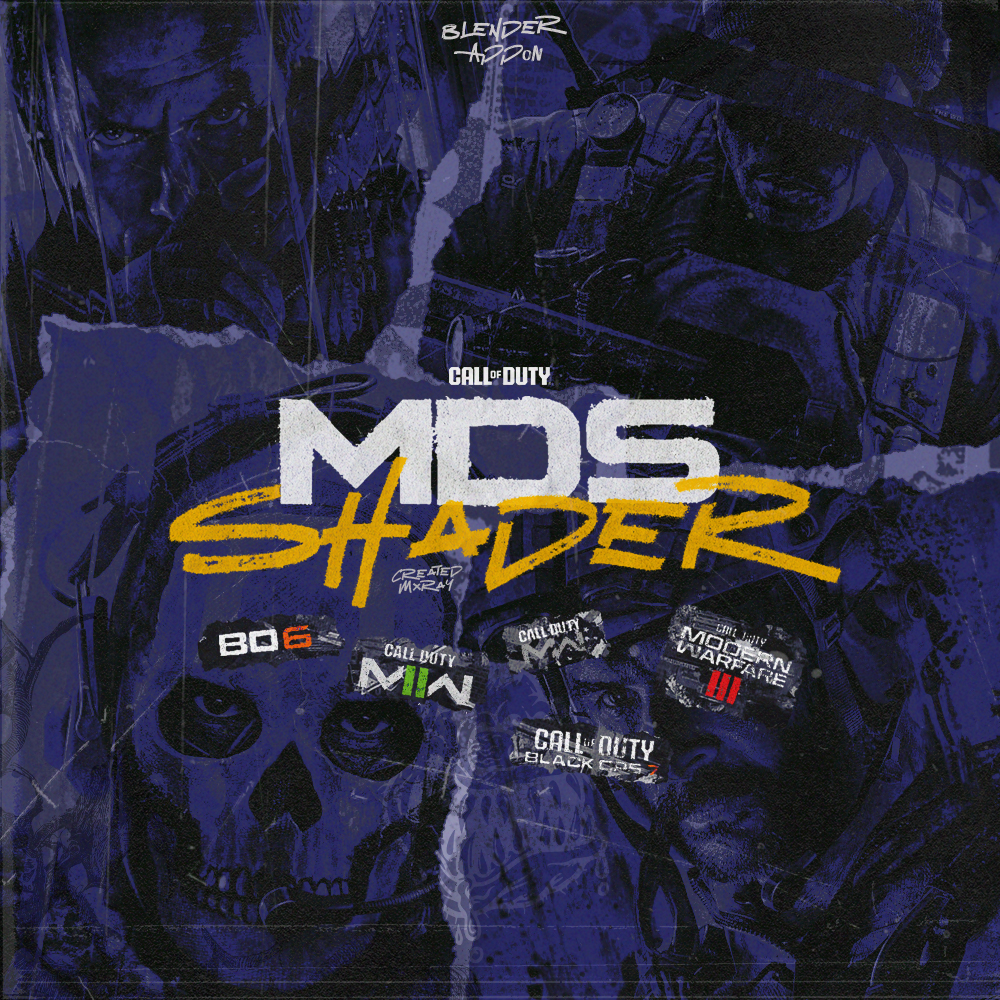
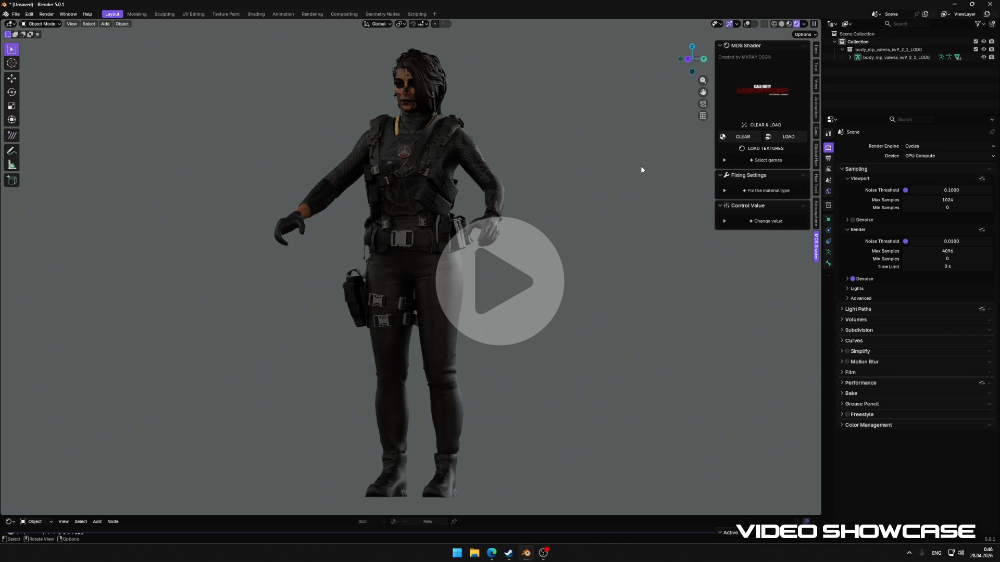
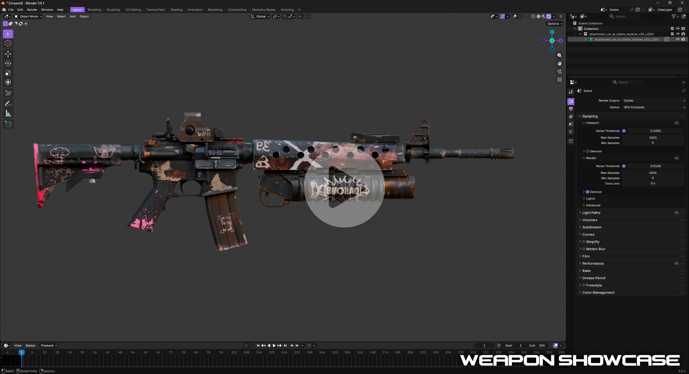
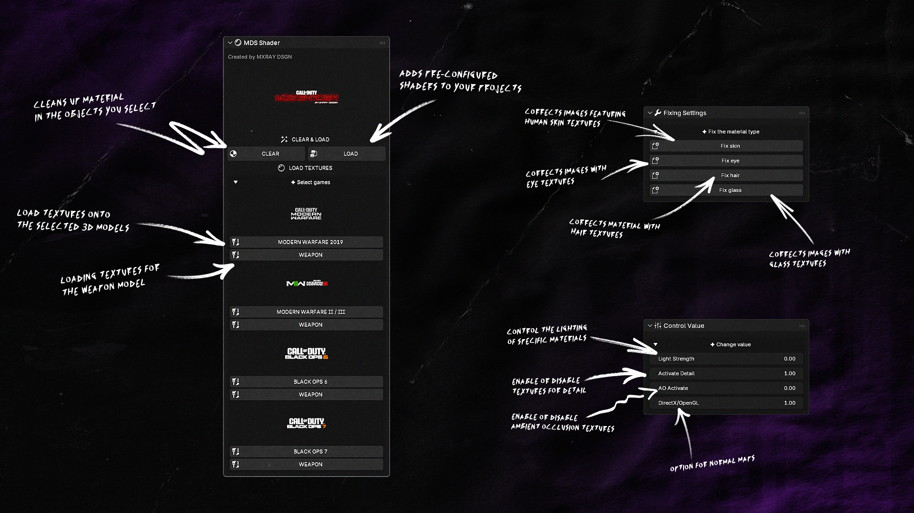
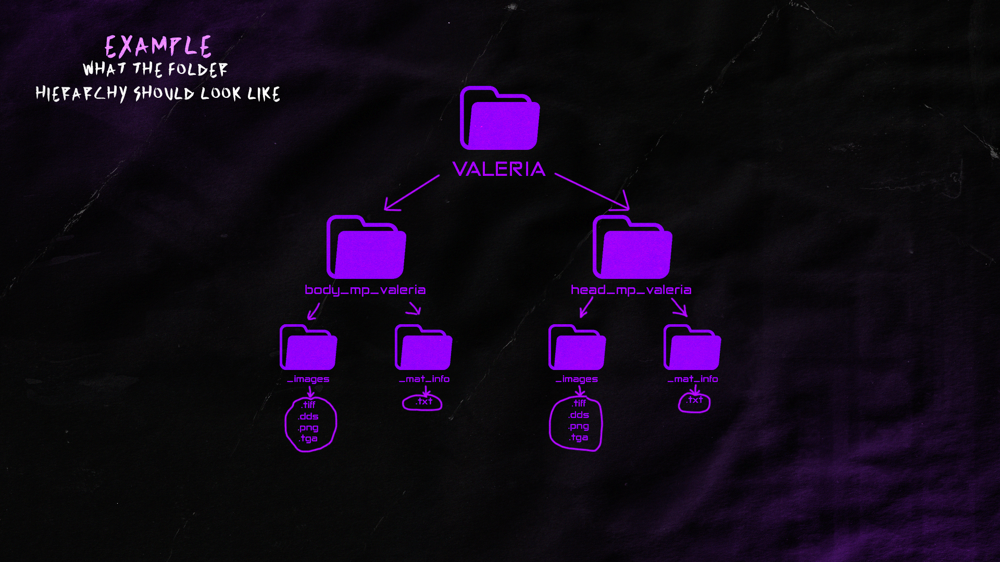
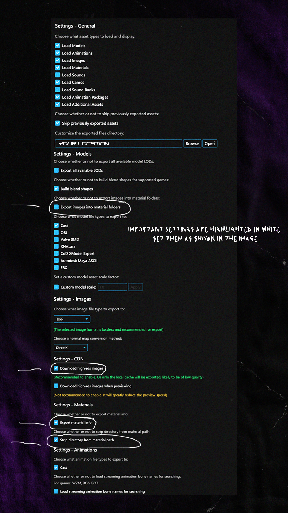

  

# MDS SHADER
*ADDON AUTOSHADER FOR BLENDER Created by Mxray Design*

*Recommended Blender version: 5.0.1 and above*

  

  

**New UI addon that automatically downloads textures to models from the _CALL OF DUTY_ series of games.**

  

> [!NOTE]
> No need to convert textures, leave them as they are.  
> The add-on has a customized version of shaders. [*If you want, you can download the shader here.*](https://github.com/Mxraydsgn/Mxray-cod-shader) 
> The add-on currently only works with the following game series:
> - Modern Warfare 2019
> - Modern Warfare II/III
> - Black Ops 6/7

> [!WARNING]
> The add-on only works with images in (.tiff .dds .png .tga) format and (.cast) models.
> 
> The “_Images” folder should not contain folders with the names of materials that contain images. It should only contain images and nothing else.
> 

# :ledger: Programs I use to export models:
[Official dest1yo's discord](https://discord.gg/VKWWHd9tf) *(all the necessary programs are here)*
- Cordycep 
- Saluki

## MY SALUKI SETTINGS

## MY SOCIAL LINKS:
- [Open3dLab](https://open3dlab.com/user/171587/)
- [Pinterest](https://www.pinterest.com/mxrdsng/mxraydesign/)
- [Steam](https://steamcommunity.com/id/dilifamusic/)
- [Instagram](https://www.instagram.com/prod.dilifa/)
- Discord: DILIFA
